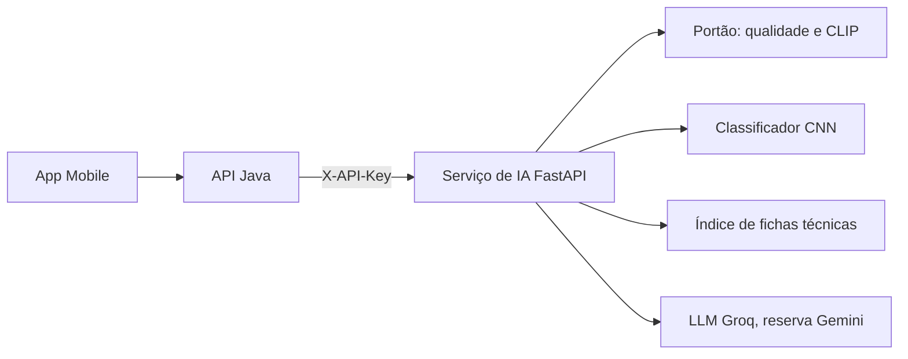

# Valence IA

Serviço de IA do Valence, rede pública de vigilância fitossanitária (Global Solution FIAP 2026/2, tema CitizenTech). Disciplina: Disruptive Architectures: IoT, IoB & Generative IA.

## Integrantes

| Nome | RM |
| --- | --- |
| Henrique Martins | 563620 |
| Guilherme Macedo | 562396 |
| Pedro Henrique | 563405 |

## Descrição

O pequeno produtor fotografa a folha doente e descreve o que vê no app. A API Java do Valence envia a foto e o relato a este serviço, que:

1. Classifica a doença na foto (visão computacional, 17 classes de milho, tomate e batata do PlantVillage).
2. Busca trechos de fichas técnicas da Embrapa e do Agrofit sobre as doenças prováveis (RAG básico com embeddings locais).
3. Gera uma explicação em linguagem simples com um LLM a partir dos trechos recuperados (IA generativa: Groq, com Gemini de reserva).

O benefício: o produtor isolado recebe uma triagem em minutos, com a fonte de cada informação, e o agrônomo recebe o caso já estruturado.

### Estado atual

Esta versão é a base do serviço: configuração, contratos, formato de erro, chave de acesso, mascaramento de dados pessoais, logs e as interfaces dos componentes. O classificador, o portão de qualidade, o índice e o cliente do LLM entram nas próximas etapas. Enquanto não estiverem carregados, `/health` responde `degradado` e as rotas de visão e RAG respondem 503.

## Arquitetura



| Componente | Interface | Papel |
| --- | --- | --- |
| `visao` | `app.visao.Classificador` | Top 3 doenças dentro da cultura informada |
| `portao` | `app.visao.Portao` | Recusa foto escura, borrada, que não é planta ou de outra cultura |
| `indice` | `app.rag.Indice` | Busca semântica nas fichas técnicas |
| `llm` | `app.rag.ClienteLlm` | Explicação a partir dos trechos, com reserva |

Cada componente é carregado no início do serviço (`lifespan`). Se um falhar, o serviço sobe assim mesmo e registra o componente como `indisponivel`.

## Endpoints

| Método | Rota | Chave | Descrição |
| --- | --- | --- | --- |
| POST | `/api/v1/visao/classificar` | Sim | multipart com `imagem` (JPEG, PNG ou WebP, até 8 MB) e `cultura` |
| POST | `/api/v1/rag/consultar` | Sim | JSON com `cultura`, `sintomas` (até 1000 caracteres) e `classes` (opcional, até 3) |
| GET | `/health` | Não | Estado do serviço e de cada componente |

`cultura` aceita maiúsculas ou minúsculas e é normalizada para `MILHO`, `TOMATE` ou `BATATA`. A documentação interativa fica em `http://localhost:8000/docs`.

Resposta de `/api/v1/visao/classificar`:

```json
{
  "imagemValida": true,
  "motivo": null,
  "culturaDetectada": "MILHO",
  "classes": [
    { "rotulo": "milho_ferrugem_comum", "nome": "Ferrugem-comum", "confianca": 0.8123 }
  ]
}
```

Resposta de `/api/v1/rag/consultar`:

```json
{
  "trechos": [
    { "titulo": "...", "texto": "...", "fonte": "Embrapa", "url": "...", "score": 0.82 }
  ],
  "explicacao": "...",
  "modeloLlm": "openai/gpt-oss-20b"
}
```

Erros seguem o formato comum do Valence:

```json
{
  "timestamp": "2026-11-11T14:32:00Z",
  "status": 400,
  "erro": "Requisição inválida",
  "mensagem": "Um ou mais campos são inválidos.",
  "caminho": "/api/v1/rag/consultar",
  "campos": [{ "campo": "sintomas", "mensagem": "Deve ter no máximo 1000 caracteres." }]
}
```

| Status | Quando |
| --- | --- |
| 400 | Campo inválido, cultura fora do enum, imagem ilegível, rótulo desconhecido |
| 401 | `X-API-Key` ausente ou errada |
| 404 | Rota inexistente |
| 413 | Imagem acima de `TAMANHO_MAXIMO_MB` |
| 415 | Arquivo que não é JPEG, PNG ou WebP |
| 422 | Classe enviada ao RAG que não pertence à cultura |
| 500 | Erro inesperado (sem detalhes na resposta) |
| 503 | Componente necessário não carregado |

Toda resposta traz o cabeçalho `X-Request-ID`, o mesmo id registrado no log.

## Como rodar

Pré-requisito: Python 3.11.

```bash
python -m venv .venv
source .venv/bin/activate          # Windows: .venv\Scripts\activate
pip install -r requirements-dev.txt
cp .env.example .env               # Windows: copy .env.example .env
uvicorn app.main:app --port 8000 --no-access-log
```

No Linux sem GPU, instale o torch para CPU antes, para não baixar a versão com CUDA:

```bash
pip install --index-url https://download.pytorch.org/whl/cpu torch==2.14.1 torchvision==0.29.1
```

O `--no-access-log` desliga o log padrão do Uvicorn, que registraria o IP do cliente. O serviço já registra o próprio log de cada requisição.

### Docker

```bash
docker build -t valence-ia .
docker run --rm -p 8000:8000 --env-file .env -v "$(pwd)/modelos:/app/modelos" valence-ia
```

A imagem usa `python:3.11-slim`, torch só para CPU e roda com usuário sem privilégio de root. Os modelos ficam fora da imagem, na pasta `modelos/` montada como volume.

### Testes e lint

```bash
pytest
ruff check .
ruff format --check .
```

Os testes usam implementações falsas das interfaces (`tests/conftest.py`), então rodam sem baixar modelos nem chamar o LLM.

## Variáveis de ambiente

| Variável | Padrão | Uso |
| --- | --- | --- |
| `MODELO_VISAO_PATH` | `modelos/visao.pt` | Pesos do classificador; a ordem das classes vem de `modelos/visao.json` |
| `CONFIANCA_MINIMA` | `0.6` | Abaixo disso o caso vai para o agrônomo sem alerta |
| `PORTAO_MODELO` | `openai/clip-vit-base-patch32` | Modelo do portão (é planta? qual cultura?) |
| `EMBEDDINGS_MODELO` | `sentence-transformers/paraphrase-multilingual-MiniLM-L12-v2` | Embeddings do RAG |
| `INDICE_PATH` | `modelos/indice` | Pasta do índice das fichas técnicas |
| `LLM_BASE_URL` | `https://api.groq.com/openai/v1` | LLM principal (API compatível com OpenAI) |
| `LLM_API_KEY` | vazio | Chave da Groq |
| `LLM_MODEL` | `openai/gpt-oss-20b` | Modelo principal |
| `LLM_FALLBACK_BASE_URL` | `https://generativelanguage.googleapis.com/v1beta/openai/` | LLM reserva |
| `LLM_FALLBACK_API_KEY` | vazio | Chave do Gemini |
| `LLM_FALLBACK_MODEL` | `gemini-3.5-flash-lite` | Modelo reserva |
| `LLM_TIMEOUT_SECONDS` | `4` | Tempo limite por provedor |
| `IA_API_KEY` | vazio | Chave exigida no `X-API-Key`; vazia desliga a checagem |
| `TAMANHO_MAXIMO_MB` | `8` | Tamanho máximo da imagem |
| `DEMO_HABILITADA` | `true` | Liga a demo Gradio em `/demo` |

Nenhuma chave real vai para o repositório: o `.env` está no `.gitignore` e o `.env.example` só tem valores fictícios.

## Dados

`dados/rotulos.json` lista as 17 classes com rótulo, classe original do PlantVillage, cultura, nome popular, nome científico e se a folha é saudável. Nomes conferidos em publicações da Embrapa (Agência de Informação Tecnológica, Sistemas de Produção e Infoteca-e). A ordem de saída do modelo vem de `modelos/visao.json`, gerado no treino.

## Uso responsável

- Os sintomas passam por `mascarar_dados_pessoais` antes de qualquer uso: e-mail, telefone, CPF, CEP e coordenadas viram `[removido]`. Nada disso chega ao índice nem ao LLM.
- Os logs registram só id da requisição, método, rota, status e duração. Nunca imagem, sintomas ou cabeçalhos.
- Respostas de erro 500 não expõem detalhes internos.
- A Groq é a primeira opção de LLM porque o plano gratuito do Gemini pode usar o conteúdo enviado.

## Limitações conhecidas

- O PlantVillage tem fotos de laboratório com fundo liso; o desempenho cai em fotos de campo.
- Só milho, tomate e batata; outras culturas são recusadas.
- A classe do vírus do enrolamento-amarelo (TYLCV) vem do PlantVillage, mas a Embrapa registra que essa espécie ainda não foi detectada no Brasil. No campo brasileiro, sintomas parecidos vêm de outros begomovírus.
- A explicação do LLM é apoio à decisão e não substitui o agrônomo.

## Uso de IA generativa

| Ferramenta | Para quê |
| --- | --- |
| Claude Code (Anthropic) | Gerar a base do serviço (estrutura FastAPI, formato de erro, chave de acesso, mascaramento, logs, testes, Dockerfile e este README), consultar versões estáveis das bibliotecas e conferir nomes das doenças em publicações da Embrapa. Todo o código foi revisado e testado pelo integrante responsável |
| Groq `openai/gpt-oss-20b` | No produto: gera a explicação da triagem a partir dos trechos recuperados |
| Gemini `gemini-3.5-flash-lite` | No produto: reserva quando a Groq falha ou passa do tempo limite |
