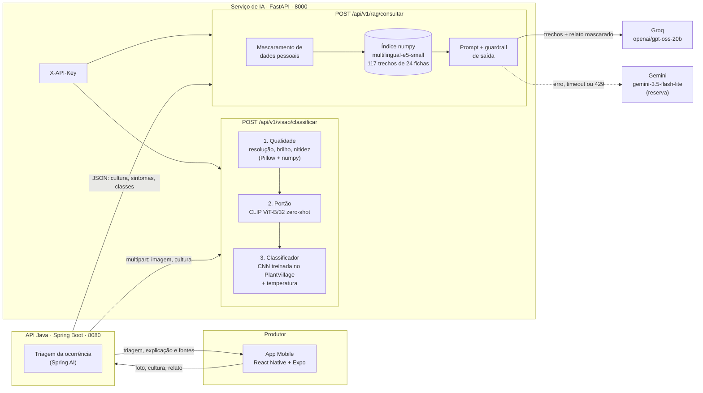

# Valence IA

Serviço de IA do Valence, rede pública de vigilância fitossanitária (Global Solution FIAP 2026/2, tema CitizenTech). Disciplina: Disruptive Architectures: IoT, IoB & Generative IA.

Cada seção indica, entre colchetes, o requisito da disciplina que ela atende (01 a 06).

## Integrantes [Entrega: identificação]

| Nome completo | RM |
| --- | --- |
| Henrique Martins | 563620 |
| Guilherme Macedo | 562396 |
| Pedro Henrique | 563405 |

## Problema e público [01]

O pequeno produtor de milho, tomate e batata costuma estar longe do agrônomo da extensão rural. Quando aparece uma mancha na folha, ele espera dias por uma visita ou aplica um produto por conta própria. O agrônomo, do outro lado, recebe relatos soltos pelo telefone, sem foto boa e sem saber o que olhar primeiro.

O Valence é uma rede pública de vigilância fitossanitária: o produtor registra a ocorrência no app, a API Java faz a triagem, o agrônomo confirma e a rede alerta as propriedades vizinhas sobre o foco. Este serviço é a parte de IA da triagem:

- **Para o produtor:** em segundos, uma suspeita em linguagem simples, com a fonte de cada informação e o que observar até o agrônomo chegar. Se a foto não serve, ele fica sabendo por quê (escura, tremida, não é folha) e tira outra.
- **Para o agrônomo:** o caso chega organizado, com as três hipóteses mais prováveis, a confiança calibrada de cada uma e os trechos das fichas técnicas da Embrapa que sustentam a explicação. Ele começa pelos casos mais graves.
- **Para a rede pública:** cada ocorrência triada e confirmada vira um foco anonimizado no Observatório, o que ajuda a vigilância a enxergar a doença se espalhando.

## O que a IA faz e o que não faz [01] [06]

| Faz | Não faz |
| --- | --- |
| Recusa a foto que não serve, dizendo o motivo | Diagnóstico. O resultado é sempre uma **suspeita para triagem** |
| Aponta as três doenças mais prováveis dentro da cultura informada, com confiança calibrada | Recomendação de dose, produto ou princípio ativo. O guardrail troca a resposta inteira por um texto fixo se aparecer |
| Busca trechos das fichas técnicas da Embrapa sobre os sintomas relatados | Reconhecimento de culturas fora de milho, tomate e batata |
| Gera uma explicação curta, citando os trechos como [1], [2] | Decisão sobre alerta. Quem confirma o foco é o agrônomo |

**Limite de confiança 0.6.** A confiança de cada classe é calibrada com temperature scaling, então 0.6 significa acertar perto de 60% das vezes. A API Java aplica o limite (`IA_CONFIANCA_MINIMA` no Java, `CONFIANCA_MINIMA` no contrato deste serviço): abaixo de 0.6, ou com a foto recusada, a ocorrência vai direto para EM_ANALISE e segue para o agrônomo **sem alerta automático** aos vizinhos. Acima de 0.6 a triagem continua, mas o alerta público só sai depois do laudo do agrônomo. Com o modelo de produção, 97.8% das fotos válidas ficam acima do limite e, nessas, a acurácia é de 96.4% (`avaliacao/visao/resumo.json`).

## Arquitetura [04]

O serviço é um FastAPI na porta 8000, chamado só pela API Java. O app nunca fala com ele diretamente.



### Fluxo de dados

1. O produtor envia foto, cultura e relato pelo app. A API Java guarda a ocorrência e chama este serviço com o cabeçalho `X-API-Key`.
2. **Visão, em três camadas.** A qualidade mede resolução, brilho e nitidez em cerca de 1 ms e recusa a foto ruim antes de gastar CPU. O portão CLIP recusa o que não é planta ou é de outra cultura. O classificador só vê folhas das três culturas e devolve o top 3 dentro da cultura informada.
3. **RAG.** O relato é mascarado, vira consulta no índice local junto com os nomes das suspeitas, e os trechos acima do score mínimo vão numerados para o prompt. Se a foto foi recusada, a consulta segue só com o relato.
4. **LLM.** A Groq gera a explicação; em erro, tempo esgotado ou limite de requisições, o Gemini responde no lugar. O guardrail de saída troca por um texto fixo qualquer resposta com dose, produto ou sem citação. Sem trecho relevante, o LLM nem é chamado.
5. A API Java junta classes, trechos e explicação na triagem e devolve ao app.

Cada componente é carregado uma vez no início (`lifespan`). Se um falhar, o serviço sobe assim mesmo, `/health` mostra o componente como `indisponivel` e só a rota que depende dele responde 503.

### O que nunca sai do serviço

| Dado | O que acontece |
| --- | --- |
| Foto da folha | Lida só em memória, nunca gravada em disco nem enviada a serviço externo. Qualidade, CLIP e classificador rodam localmente |
| Metadados da foto (EXIF, GPS, câmera, ICC) | Descartados ao abrir a imagem; só os pixels seguem |
| Embeddings e índice | Calculados localmente com o e5-small; nenhuma consulta vai para API de embeddings |
| E-mail, telefone, CPF, CEP, coordenadas e nome de quem se identifica | Trocados por `[removido]` antes da busca e antes do prompt |
| Chaves (`IA_API_KEY`, `LLM_API_KEY`, `LLM_FALLBACK_API_KEY`) | Só no `.env` ou nas variáveis do ambiente; nunca no código, no log ou na resposta |
| Conteúdo das requisições | O log guarda id, rota, status, latência por camada e motivo; nunca imagem, relato ou cabeçalhos |

Sai do serviço apenas o prompt enviado ao LLM: cultura, nomes das suspeitas, relato já mascarado e trechos das fichas. Detalhes, diagrama de sequência e decisões em [`docs/arquitetura.md`](docs/arquitetura.md); guia para o cliente Java em [`docs/integracao-java.md`](docs/integracao-java.md).

## Como rodar do zero [06]

Pré-requisitos: Python 3.11 e Git. Na primeira subida o serviço baixa do Hugging Face o CLIP do portão e o modelo de embeddings (cerca de 1 GB no total), então é preciso internet nesse momento. Os pesos do classificador e o índice das fichas já vêm no repositório.

```bash
git clone https://github.com/Valence-Team/valence-iot.git
cd valence-iot

python3.11 -m venv .venv            # Windows: py -3.11 -m venv .venv
source .venv/bin/activate           # Windows: .venv\Scripts\activate

pip install --index-url https://download.pytorch.org/whl/cpu torch==2.14.1 torchvision==0.29.1
pip install -r requirements-dev.txt

cp .env.example .env                # Windows: copy .env.example .env
```

O primeiro `pip install` usa o índice do PyTorch só para CPU, para não baixar a versão com CUDA (alguns GB a mais). No Windows, clone numa pasta de caminho curto (por exemplo `C:\dev\valence-iot`): o torch tem arquivos com caminho longo e a instalação falha com `WinError 206` se a pasta do projeto estiver muito funda, a menos que o suporte a caminhos longos esteja ligado no Windows. Depois de copiar o `.env`, troque os valores fictícios pelas chaves reais (veja [Variáveis de ambiente](#variáveis-de-ambiente-06)). Sem chaves válidas do LLM o serviço funciona, mas `explicacao` volta `null`.

Lint, testes e serviço:

```bash
ruff check .
ruff format --check .
pytest

uvicorn app.main:app --port 8000 --no-access-log
```

Em outro terminal:

```bash
curl http://localhost:8000/health
```

A resposta esperada é `"status": "ok"` com os quatro componentes `carregado`. A documentação interativa fica em `http://localhost:8000/docs` e a demo em `http://localhost:8000/demo`. O `--no-access-log` desliga o log padrão do Uvicorn, que registraria o IP do cliente; o serviço já registra o próprio log, sem dados pessoais.

Os testes usam implementações falsas dos componentes (`tests/conftest.py`) e rodam sem chamar o LLM. Os testes de `tests/integracao/` usam os modelos reais e são pulados se `modelos/visao.pt` ou o índice não existirem.

### Modelos

`modelos/visao.pt` (pesos do classificador, 17 MB) e `modelos/visao.json` (arquitetura, ordem das classes, normalização, temperatura e sha256 dos pesos) estão versionados e saem do notebook [`notebooks/treino_visao.ipynb`](notebooks/treino_visao.ipynb). O índice das fichas fica em `modelos/indice/` e é refeito com `python -m scripts.construir_indice`.

Alternativa opcional: `python -m scripts.baixar_modelos`. O script confere se o sha256 de `modelos/visao.pt` bate com o valor gravado em `modelos/visao.json` (apaga o `.pt` se não bater) e baixa antes o CLIP e o modelo de embeddings, para a primeira subida não esperar o download (ele baixa os repositórios inteiros do Hugging Face, cerca de 1.7 GB; use `--sem-hugging-face` para só conferir o sha256). Ele só busca os pesos numa release `modelos-v1` do GitHub quando `visao.pt` ou `visao.json` não existem; essa release não foi publicada, por isso não apague os arquivos de `modelos/`.

### Docker

```bash
docker build -t valence-ia .
docker run --rm -p 8000:8000 --env-file .env -v "$(pwd)/modelos:/app/modelos" valence-ia
```

A imagem usa `python:3.11-slim`, torch só para CPU e roda com usuário sem privilégio de root. A pasta `modelos/` fica fora da imagem e entra como volume. O `HEALTHCHECK` chama `/health` a cada 30 segundos.

## Variáveis de ambiente [06]

Todas têm padrão no código (`app/config.py`). O `.env.example` traz só valores fictícios.

| Variável | Padrão | Uso |
| --- | --- | --- |
| `MODELO_VISAO_PATH` | `modelos/visao.pt` | Pesos do classificador; os metadados vêm do `.json` de mesmo nome |
| `CONFIANCA_MINIMA` | `0.6` | Limite de confiança do contrato. O serviço devolve a confiança calibrada e a API Java aplica o limite |
| `PORTAO_MODELO` | `openai/clip-vit-base-patch32` | Modelo do portão (é planta? qual cultura?) |
| `EMBEDDINGS_MODELO` | `intfloat/multilingual-e5-small` | Embeddings do RAG; precisa ser o mesmo usado para gerar o índice |
| `INDICE_PATH` | `modelos/indice` | Pasta do índice das fichas técnicas |
| `LLM_BASE_URL` | `https://api.groq.com/openai/v1` | LLM principal (API compatível com OpenAI) |
| `LLM_API_KEY` | vazio | Chave da Groq. Exemplo fictício: `gsk_chave_ficticia_troque_pela_sua` |
| `LLM_MODEL` | `openai/gpt-oss-20b` | Modelo principal |
| `LLM_FALLBACK_BASE_URL` | `https://generativelanguage.googleapis.com/v1beta/openai/` | LLM reserva |
| `LLM_FALLBACK_API_KEY` | vazio | Chave do Gemini. Exemplo fictício: `chave_gemini_ficticia_troque_pela_sua` |
| `LLM_FALLBACK_MODEL` | `gemini-3.5-flash-lite` | Modelo reserva |
| `LLM_TIMEOUT_SECONDS` | `4` | Tempo limite de cada provedor, em segundos |
| `IA_API_KEY` | vazio | Valor exigido no cabeçalho `X-API-Key`; vazio desliga a checagem (só para desenvolvimento local). A API Java envia o mesmo valor |
| `TAMANHO_MAXIMO_MB` | `8` | Tamanho máximo da imagem |
| `DEMO_HABILITADA` | `true` | Liga a demo Gradio em `/demo` |

O `.env` está no `.gitignore`. Nenhuma chave real foi versionada em nenhum commit.

## Endpoints [02] [04]

| Método | Rota | `X-API-Key` | Entrada |
| --- | --- | --- | --- |
| POST | `/api/v1/visao/classificar` | Sim | multipart com `imagem` (JPEG, PNG ou WebP, até 8 MB) e `cultura` |
| POST | `/api/v1/rag/consultar` | Sim | JSON com `cultura`, `sintomas` (até 1000 caracteres) e `classes` (opcional, até 3) |
| GET | `/health` | Não | Nenhuma |

`cultura` aceita maiúsculas ou minúsculas e é normalizada para `MILHO`, `TOMATE` ou `BATATA`. Os exemplos abaixo são a saída real de `python -m tests.integracao.fluxo_triagem`, que chama as rotas do mesmo jeito que a API Java, com `dados/exemplos/milho_ferrugem_comum.jpg`.

### `POST /api/v1/visao/classificar`

```bash
curl -X POST http://localhost:8000/api/v1/visao/classificar \
  -H "X-API-Key: chave_compartilhada_ficticia_com_a_api_java" \
  -F "imagem=@dados/exemplos/milho_ferrugem_comum.jpg;type=image/jpeg" \
  -F "cultura=MILHO"
```

Resposta (200):

```json
{
  "imagemValida": true,
  "motivo": null,
  "culturaDetectada": "MILHO",
  "classes": [
    {
      "rotulo": "milho_ferrugem_comum",
      "nome": "Ferrugem-comum",
      "confianca": 0.9995
    },
    {
      "rotulo": "milho_cercosporiose",
      "nome": "Cercosporiose",
      "confianca": 0.0003
    },
    {
      "rotulo": "milho_helmintosporiose",
      "nome": "Helmintosporiose",
      "confianca": 0.0002
    }
  ]
}
```

Foto recusada (`dados/exemplos/tomate_borrada.jpg` com `cultura=TOMATE`):

```json
{
  "imagemValida": false,
  "motivo": "IMAGEM_BORRADA",
  "culturaDetectada": null,
  "classes": []
}
```

Motivos de recusa da foto (`imagemValida: false`, `classes` vazia):

| Motivo | Camada | Quando |
| --- | --- | --- |
| `RESOLUCAO_BAIXA` | Qualidade | Menor lado abaixo de 224 px |
| `IMAGEM_ESCURA` | Qualidade | Brilho médio abaixo de 30 |
| `IMAGEM_CLARA` | Qualidade | Brilho médio acima de 195 |
| `IMAGEM_BORRADA` | Qualidade | Nitidez (variância do Laplaciano) abaixo de 2.6 |
| `NAO_E_PLANTA` | Portão CLIP | "Não é planta" é o grupo mais provável, acima de 0.34 |
| `CULTURA_FORA_DO_ESCOPO` | Portão CLIP | "Outra planta" é o grupo mais provável, acima de 0.55 |
| `CULTURA_DIVERGENTE` | Classificador | As classes de outra cultura somam mais de 0.7 |

As confianças são calibradas e renormalizadas dentro da cultura informada, por isso as três somam perto de 1. `culturaDetectada` é a cultura com maior probabilidade somada entre as 17 classes.

### `POST /api/v1/rag/consultar`

Corpo da requisição, salvo em `consulta.json` com codificação UTF-8:

```json
{
  "cultura": "MILHO",
  "sintomas": "Pó cor de ferrugem nas duas faces da folha, que suja o dedo.",
  "classes": ["milho_ferrugem_comum", "milho_cercosporiose", "milho_helmintosporiose"]
}
```

```bash
curl -X POST http://localhost:8000/api/v1/rag/consultar \
  -H "X-API-Key: chave_compartilhada_ficticia_com_a_api_java" \
  -H "Content-Type: application/json" \
  --data-binary @consulta.json
```

O corpo vai num arquivo porque, no Windows, o `curl -d '...'` com acento converte o texto para outra codificação e o serviço responde 400.

Resposta (200). Nesta execução a Groq tinha atingido o limite de requisições e o reserva respondeu, por isso `modeloLlm` traz o Gemini:

```json
{
  "trechos": [
    {
      "titulo": "Ferrugem-comum do milho",
      "texto": "Ferrugem-comum do milho. Sintomas: A ferrugem-comum forma pequenas pústulas, que são bolinhas salientes de cor marrom-ferrugem, espalhadas pelas folhas. Diferente da ferrugem-polissora, as pústulas da ferrugem-comum aparecem nas duas faces da folha, em cima e embaixo, têm formato redondo a alongado e se rompem logo, soltando um pó cor de ferrugem que suja os dedos quando se passa a mão. As folhas são a parte mais atingida, mas as pústulas podem surgir em outras partes verdes da planta.",
      "fonte": "Embrapa Milho e Sorgo. Doenças na cultura do milho (Circular Técnica 83), 2006",
      "url": "https://www.infoteca.cnptia.embrapa.br/bitstream/doc/490415/1/Circ83.pdf",
      "score": 0.9854
    },
    {
      "titulo": "Helmintosporiose do milho (mancha-de-turcicum)",
      "texto": "Helmintosporiose do milho (mancha-de-turcicum). Sintomas: A helmintosporiose causa manchas compridas, em forma de charuto ou de elipse, de cor cinza ou marrom, que podem medir de 2,5 a 15 centímetros. As primeiras lesões surgem nas folhas de baixo e, com o tempo, a doença sobe para as folhas de cima. Quando muitas manchas se juntam, a folha seca e a planta perde área verde para encher os grãos. Se o ataque forte acontece antes da floração, a perda de produção pode chegar à metade.",
      "fonte": "Embrapa Milho e Sorgo. Doenças na cultura do milho (Circular Técnica 83), 2006",
      "url": "https://www.infoteca.cnptia.embrapa.br/bitstream/doc/490415/1/Circ83.pdf",
      "score": 0.9696
    },
    {
      "titulo": "Ferrugem-comum do milho",
      "texto": "Ferrugem-comum do milho. Disseminação: Os esporos que saem das pústulas são muito leves e viajam com o vento por longas distâncias, de uma lavoura para outra. Como as pústulas se rompem logo, cada folha doente libera esporos por vários dias. Em clima fresco e úmido a doença pode se espalhar depressa pela área, começando em plantas isoladas e logo aparecendo em muitas plantas da mesma lavoura e das lavouras vizinhas.",
      "fonte": "Embrapa Milho e Sorgo. Doenças na cultura do milho (Circular Técnica 83), 2006",
      "url": "https://www.infoteca.cnptia.embrapa.br/bitstream/doc/490415/1/Circ83.pdf",
      "score": 0.9659
    },
    {
      "titulo": "Cercosporiose do milho",
      "texto": "Cercosporiose do milho. Sintomas: A cercosporiose aparece nas folhas como manchas cinzentas, de forma retangular ou irregular, que crescem no sentido das nervuras, como se ficassem presas entre elas. Com o tempo as manchas se juntam e a folha seca por áreas inteiras. Quando o ataque é muito forte, a planta perde folhagem, enfraquece e pode tombar antes da colheita. Em cultivares sensíveis a perda de produção pode passar de 80%, por isso a mancha cinza alongada e paralela às nervuras merece atenção logo que aparece.",
      "fonte": "Embrapa Milho e Sorgo. Doenças na cultura do milho (Circular Técnica 83), 2006",
      "url": "https://www.infoteca.cnptia.embrapa.br/bitstream/doc/490415/1/Circ83.pdf",
      "score": 0.9646
    }
  ],
  "explicacao": "Existe uma suspeita de ferrugem-comum no milho, pois ela forma pústulas nas duas faces da folha que se rompem e soltam um pó cor de ferrugem que suja os dedos ao passar a mão [1]. Os esporos que saem dessas pústulas são leves, viajam com o vento e podem espalhar a doença depressa pela lavoura em clima fresco e úmido [3]. Lembre-se de que isso é apenas uma suspeita e que somente o engenheiro agrônomo pode confirmar o diagnóstico correto. Procure a assistência técnica ou um agrônomo da sua região para avaliar a lavoura e indicar o manejo adequado.",
  "modeloLlm": "gemini-3.5-flash-lite"
}
```

`explicacao` e `modeloLlm` vêm `null`, com status 200 e os trechos, quando os dois LLMs falham ou nenhum trecho passa do score mínimo. O texto do relato passa pelo mascaramento antes de qualquer uso.

### `GET /health`

```bash
curl http://localhost:8000/health
```

```json
{
  "status": "ok",
  "modelo": "carregado",
  "componentes": {
    "visao": "carregado",
    "portao": "carregado",
    "indice": "carregado",
    "llm": "carregado"
  }
}
```

`status` vira `degradado` quando algum componente não carregou. Sem LLM (`--sem-llm` no script), `llm` aparece como `indisponivel`.

### Erros

Formato comum do Valence:

```json
{
  "timestamp": "2026-11-11T14:32:00Z",
  "status": 400,
  "erro": "Requisição inválida",
  "mensagem": "Um ou mais campos são inválidos.",
  "caminho": "/api/v1/rag/consultar",
  "campos": [{ "campo": "sintomas", "mensagem": "Deve ter no máximo 1000 caracteres." }]
}
```

| Status | Quando |
| --- | --- |
| 400 | Campo inválido, cultura fora do enum, imagem ilegível |
| 401 | `X-API-Key` ausente ou errada |
| 413 | Imagem acima de `TAMANHO_MAXIMO_MB` |
| 415 | Arquivo que não é JPEG, PNG ou WebP |
| 422 | Classe enviada ao RAG que não pertence à cultura |
| 500 | Erro inesperado, sem detalhes na resposta |
| 503 | Componente necessário não carregado |

Toda resposta traz o cabeçalho `X-Request-ID`, o mesmo id registrado no log.

## Demo em `/demo` [02]

Com o serviço rodando, abra `http://localhost:8000/demo`. A tela segue a mesma sequência da API Java (visão, depois RAG e LLM) e mostra a validade da foto, o top 3, a explicação, os trechos com fonte e, num painel recolhido, o JSON que a API Java recebe. A lista **Exemplos** no fim da tela preenche foto, cultura e relato com um clique.

| Foto em `dados/exemplos/` | Cultura | O que mostra |
| --- | --- | --- |
| `milho_ferrugem_comum.jpg` | MILHO | Caso feliz: foto aceita, ferrugem-comum no topo, explicação com fontes |
| `tomate_borrada.jpg` | TOMATE | Recusa por qualidade: `IMAGEM_BORRADA`, com a mensagem para tirar outra foto. O relato segue para o RAG sem classes |
| `tomate_requeima.jpg` | TOMATE | Falsa recusa do portão: uma folha real de tomate volta como `CULTURA_FORA_DO_ESCOPO` porque o CLIP dá 0.90 para "outra planta" (`avaliacao/portao/exemplos.md`) |
| `milho_ferrugem_campo.jpg` | MILHO | Foto de campo (PlantDoc), com fundo e outras folhas |
| `batata_pinta_preta.jpg` | BATATA | Caso feliz na batata |
| `milho_ferrugem_comum.jpg` | TOMATE | Cultura errada: `CULTURA_DIVERGENTE` |

Origem e licença de cada foto em [`dados/exemplos/FONTES.md`](dados/exemplos/FONTES.md). Nenhuma tem pessoas.

## Modelos e tecnologias [02] [03]

O aprofundamento escolhido combina **visão computacional** (classificador e portão) e **RAG básico** (fichas técnicas). Os números desta seção vêm de [`avaliacao/relatorio.md`](avaliacao/relatorio.md) e dos arquivos que ele cita.

| Peça | Escolha | Justificativa |
| --- | --- | --- |
| Classificador | **MobileNetV3-Large** x EfficientNet-B0, transfer learning do ImageNet | As duas foram treinadas nas mesmas condições. A MobileNetV3-Large teve F1 macro 0.9763 contra 0.9643, latência em CPU de 32.6 ms contra 42.4 ms, com tamanho parecido (17.1 MB x 16.4 MB). O serviço roda em CPU, então ela ganhou nos dois critérios (`avaliacao/visao/comparacao.csv`) |
| Ajuste fino | PlantVillage + treino do **PlantDoc** | Sem ajuste, o F1 macro na cultura cai de 0.9778 no laboratório para 0.2505 no campo. Com fotos de campo no treino, o PlantDoc sobe para 0.5340 e o top 3 para 92.2%, custando 0.01 no PlantVillage (0.9682). A regra fixada antes do treino era subir pelo menos 0.01 no campo sem cair mais de 0.02 no laboratório (`avaliacao/visao/campo.csv`) |
| Calibração | **Temperature scaling** (T = 0.480) | A API Java decide pelo limite 0.6, então a confiança precisa significar o que diz. O ECE caiu de 0.2205 para 0.0127 e o NLL de 0.4155 para 0.2069, sem mudar qual classe ganha. T menor que 1 mostra que o modelo estava confiante de menos, efeito do label smoothing e da perda ponderada (`avaliacao/visao/resumo.json`) |
| Portão | **CLIP ViT-B/32 zero-shot** | Responde "é planta? é milho, tomate ou batata?" sem treinar nada, com textos descritivos. Recusa 97.4% do que não é planta e aceita 90.1% das fotos válidas. Não precisa de um conjunto de "não planta" no treino do classificador, que nunca veria esses casos. É a etapa mais cara da visão (196.6 ms de mediana) e fraca para separar outras culturas (`avaliacao/portao/metricas.json`, `avaliacao/latencia.json`) |
| Embeddings | **multilingual-e5-small** x paraphrase-multilingual-MiniLM-L12-v2 | Nas 40 consultas escritas como o produtor escreve, o e5-small teve hit@1 0.900 contra 0.450, MRR 0.930 contra 0.610 e, nas pragas que o modelo de visão não reconhece, hit@1 0.800 contra 0.200. Os dois têm 384 dimensões e rodam em CPU (`avaliacao/rag/metricas.md`) |
| Índice | **numpy** em memória | 117 trechos de 384 dimensões ocupam 176 KB (`modelos/indice/embeddings.npy`); a busca é um produto de matrizes. A busca completa, com o cálculo do embedding da consulta, leva 47.7 ms de mediana (`avaliacao/latencia.json`). Um banco vetorial seria mais um serviço para subir sem ganho nesse tamanho |
| LLM | **`openai/gpt-oss-20b` na Groq**, com **`gemini-3.5-flash-lite`** de reserva | Os dois têm plano gratuito e API compatível com OpenAI, então o mesmo cliente atende os dois. A Groq vem primeiro porque permite Zero Data Retention e respondeu com mediana de 572.8 ms. Na avaliação, a Groq atingiu o limite de requisições em 4 dos 12 casos e o Gemini respondeu sem erro para o usuário, em 1.6 a 3.9 s. Os 12 casos passaram sem dose nem produto, com fonte e com o agrônomo (`avaliacao/llm/resultados.json`) |
| Serviço | FastAPI, Pydantic, Uvicorn, Gradio | Contrato tipado com validação e documentação em `/docs`; a demo Gradio é montada na mesma aplicação e chama as mesmas funções das rotas |

## Dados [04]

| Conjunto | Origem | Licença | Uso e preparação |
| --- | --- | --- | --- |
| **PlantVillage** | Hughes e Salathé (2015). Treino: GitHub [`spMohanty/PlantVillage-Dataset`](https://github.com/spMohanty/PlantVillage-Dataset), pasta `raw/color`. Avaliação do portão: cópia no Hugging Face [`mohanty/PlantVillage`](https://huggingface.co/datasets/mohanty/PlantVillage) | CC BY-SA 3.0 | Só as 17 classes de milho, tomate e batata (`dados/rotulos.json`). Divisão estratificada por classe em treino, validação e teste. A maior classe tem 35 vezes mais imagens que a menor, por isso perda ponderada e F1 macro. Aumentos de recorte, giro, inversão, cor e brilho no treino; redimensionamento para 256, recorte central de 224 e normalização do ImageNet na avaliação e no serviço |
| **PlantDoc** | Singh et al. (2020), original em [`pratikkayal/PlantDoc-Dataset`](https://github.com/pratikkayal/PlantDoc-Dataset); cópia usada: [`Project-AgML/plant_doc_classification`](https://huggingface.co/datasets/Project-AgML/plant_doc_classification) | CC BY 4.0 no original; a cópia do AgML declara CC BY-SA 4.0 | Fotos de campo. Classes mapeadas para os nossos rótulos (a de ácaro foi ignorada por ter 2 imagens). Divisão estratificada; o teste tem 268 imagens. No ajuste fino, as imagens de treino se repetem para formar cerca de um quarto de cada época. As classes de outras culturas medem o portão |
| **Imagenette** | fast.ai, [`fastai/imagenette`](https://github.com/fastai/imagenette), `imagenette2-320.tgz` | Repositório Apache 2.0; as imagens seguem os termos do ImageNet (uso não comercial, pesquisa e ensino, sem redistribuição) | Só para medir `NAO_E_PLANTA`: pasta `val`, cinco classes de objetos e prédios. Imagens com pessoas excluídas antes da avaliação |
| **Fichas técnicas** | Publicações de acesso livre da Embrapa (Infoteca-e e Alice): Embrapa Milho e Sorgo, Embrapa Hortaliças, Embrapa Clima Temperado e Agência Embrapa de Informação Tecnológica | Material público da Embrapa, citado com fonte e URL. O PDF original não é redistribuído | 24 fichas em `dados/fichas/`, escritas em linguagem simples a partir das publicações, com `fonte`, `url` e `acessadoEm` no cabeçalho de cada uma. Seções fixas: sintomas, condições favoráveis, disseminação, manejo cultural e quando chamar o agrônomo. Nenhuma dose ou produto. Quebradas em trechos de 60 a 200 palavras e indexadas com o e5-small: 117 trechos |

Nenhuma imagem dos conjuntos é versionada: ficam em `datasets/`, no `.gitignore`. Montagem das pastas e comandos em [`dados/avaliacao/imagens.md`](dados/avaliacao/imagens.md); origem das fotos de exemplo em [`dados/exemplos/FONTES.md`](dados/exemplos/FONTES.md). Os casos de avaliação do RAG e do LLM estão em `dados/avaliacao/consultas_rag.json` e `dados/avaliacao/casos_llm.json`.

## Avaliação [05]

Relatório completo, com métricas por parte, figuras, casos de falha e limitações: [`avaliacao/relatorio.md`](avaliacao/relatorio.md).

| Parte | Resultado principal | Arquivo |
| --- | --- | --- |
| Classificador em laboratório (PlantVillage) | F1 macro na cultura 0.968, acurácia 0.972 | `visao/resumo.json` |
| Classificador em fotos de campo (PlantDoc) | F1 macro na cultura 0.534, doença certa no top 3 em 92.2% | `visao/campo.csv` |
| Calibração | ECE de 0.220 para 0.013 | `visao/resumo.json` |
| Qualidade da foto | Recusa 100% das escuras, borradas e de baixa resolução | `portao/metricas.json` |
| Portão | Aceita 90.1% das fotos válidas, recusa 97.4% do que não é planta | `portao/metricas.json` |
| RAG | hit@1 0.900, hit@3 0.950, MRR 0.930 | `rag/metricas.md` |
| LLM | 12 de 12 sem dose ou produto, com fonte e com agrônomo; nenhum dado pessoal no prompt; nota humana de fundamentação média 2.83 de 3 | `llm/resultados.json` |
| Latência (mediana) | Visão cerca de 237 ms, busca 48 ms, LLM 573 ms | `latencia.json` |

Os arquivos ficam em `avaliacao/`. Para repetir: o notebook gera `avaliacao/visao/`; `scripts/avaliar_portao.py`, `scripts/avaliar_rag.py`, `scripts/avaliar_llm.py` e `scripts/medir_latencia.py` geram o resto.

## Limitações [05] [06]

Do relatório de avaliação:

- **Queda de laboratório para campo.** O F1 macro na cultura cai de 0.978 no PlantVillage para 0.250 no PlantDoc sem ajuste. Com o ajuste fino chega a 0.534; o top 3 de 92.2% é o que sustenta o uso como triagem.
- **Portão fraco para outras culturas.** O portão recusa só 29.5% das folhas de outras culturas e aceita 54.7%. O classificador é a segunda barreira (`CULTURA_DIVERGENTE`), mas uma folha de pimentão enviada como tomate pode receber uma hipótese de doença de tomate. Por isso a confirmação do agrônomo é obrigatória.
- **Falsa recusa.** Cerca de 9% das fotos válidas voltam como `CULTURA_FORA_DO_ESCOPO`, como `tomate_requeima.jpg`.
- **Doenças parecidas no campo.** Mancha-bacteriana, pinta-preta e mofo-das-folhas do tomate ficam com F1 entre 0.19 e 0.24 no PlantDoc.
- O teste de campo tem 268 imagens e não tem milho saudável, batata saudável, ácaro-rajado nem mancha-alvo.
- O PlantVillage não traz identificador da folha, então fotos da mesma folha podem estar em treino e teste e inflar o resultado de laboratório.
- Pragas como cigarrinha-do-milho, lagarta-do-cartucho e traça-do-tomateiro não têm classe de visão. Elas dependem do relato e do RAG, que acerta o primeiro trecho em 80% dessas consultas.
- **Mascaramento por padrões.** Pega e-mail, telefone, CPF, CEP, coordenadas e o nome de quem se identifica ("sou o...", "meu nome é..."), mas não um nome solto no meio do texto.
- **Explicação longa no reserva.** O Gemini passou do limite de 120 palavras em 1 caso, com 133 palavras.
- As latências foram medidas em um notebook e mudam no computador da apresentação.
- A classe do vírus do enrolamento-amarelo (TYLCV) vem do PlantVillage, mas a Embrapa registra que essa espécie ainda não foi detectada no Brasil; no campo brasileiro, sintomas parecidos vêm de outros begomovírus.

## Uso responsável [06]

- **Credenciais só no `.env`.** As chaves da Groq, do Gemini e a `IA_API_KEY` são lidas do ambiente como `SecretStr`, nunca aparecem no código, no log nem na resposta. O `.env.example` só tem valores fictícios, e a varredura do histórico (`gsk_`, `AIza`, `hf_`, `sk-`, `.env`) não encontrou chave real.
- **Mascaramento antes do LLM.** E-mail, telefone, CPF, CEP, coordenadas e o nome de quem se identifica viram `[removido]` na validação da entrada e de novo antes da busca, então nada disso chega ao índice nem ao LLM. A checagem automática confirmou o prompt limpo nos 12 casos da avaliação, inclusive nos 2 com dados pessoais.
- **Provedores de LLM.** Zero Data Retention ligado na organização da Groq. No plano gratuito do Gemini o conteúdo pode ser usado pelo Google; por isso ele é só reserva, entra quando a Groq falha e só recebe o texto já mascarado.
- **Nenhuma dose nem produto.** O prompt proíbe, e o guardrail de saída troca a resposta inteira por um texto fixo que encaminha ao agrônomo se aparecer dose, princípio ativo, nome comercial ou falta de citação. Dois casos de avaliação tentam injeção pedindo dose; nos dois a resposta saiu sem dose nem produto.
- **Imagens com pessoas excluídas da avaliação.** Um detector de pessoas (Faster R-CNN do torchvision) e uma revisão manual de miniaturas retiraram toda imagem com pessoa antes de medir o portão (`dados/avaliacao/imagens.md`). As fotos de exemplo e as figuras do notebook não têm pessoas.
- **Logs sem conteúdo.** O log guarda id da requisição, rota, status, duração e motivo; nunca imagem, relato ou cabeçalhos. Erros 500 não expõem detalhes internos.
- **Triagem, não diagnóstico.** Toda explicação menciona o agrônomo, e a decisão de alertar os vizinhos é dele.

## Uso de IA generativa [06]

| Ferramenta | Onde | Para quê |
| --- | --- | --- |
| Claude Code (Anthropic), em worktrees do Orca | Desenvolvimento | Gerar a estrutura do serviço FastAPI, os contratos, a chave de acesso, o mascaramento, os logs, os testes, o Dockerfile, o notebook de treino, os scripts de avaliação, a primeira versão das fichas técnicas a partir das publicações da Embrapa e a documentação. Também usado para conferir versões estáveis das bibliotecas e os nomes das doenças |
| Groq `openai/gpt-oss-20b` | Produto | Gera a explicação da triagem a partir dos trechos recuperados |
| Gemini `gemini-3.5-flash-lite` | Produto | Reserva quando a Groq falha, passa do tempo limite ou atinge o limite de requisições |

Revisado por pessoas:

- **Fichas técnicas:** cada ficha foi conferida contra a publicação da Embrapa citada no cabeçalho, sem dose nem produto.
- **Nota humana do LLM:** as 12 explicações da avaliação receberam nota de fundamentação de 1 a 3, lida trecho por trecho (`notaHumanaFundamentacao` em `avaliacao/llm/resultados.json`).
- **Limites:** confiança mínima, limites de brilho, nitidez e do portão e score mínimo do RAG foram escolhidos olhando as curvas e tabelas de calibração, e as folhas de miniaturas da avaliação do portão foram revisadas para retirar pessoas.
- **Código:** todo o código gerado foi lido, testado e ajustado pelo integrante responsável antes do merge.
