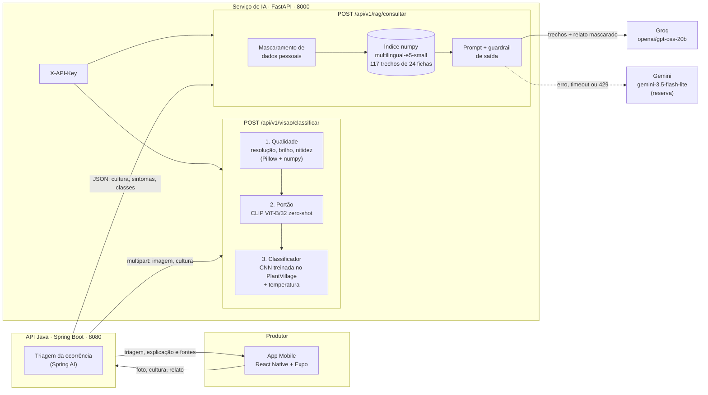
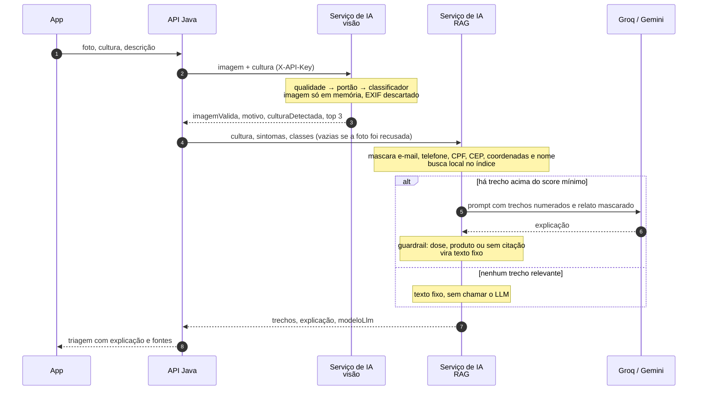

# Arquitetura do serviço de IA

O serviço de IA é um FastAPI na porta 8000, chamado só pela API Java. O app nunca fala com ele diretamente.

## Componentes

| Componente | Onde roda | Modelo ou dado | Arquivo |
| --- | --- | --- | --- |
| Qualidade | Serviço de IA, CPU | Regras com limites calibrados | `app/visao/qualidade.py` |
| Portão | Serviço de IA, CPU | `openai/clip-vit-base-patch32` (Hugging Face, local) | `app/visao/portao.py` |
| Classificador | Serviço de IA, CPU | `modelos/visao.pt` e `modelos/visao.json` (notebook de treino) | `app/visao/classificador.py` |
| Índice | Serviço de IA, CPU | `modelos/indice/` gerado de `dados/fichas/` com `intfloat/multilingual-e5-small` | `app/rag/indice.py` |
| LLM principal | Groq (externo) | `openai/gpt-oss-20b` | `app/rag/llm.py` |
| LLM reserva | Google (externo) | `gemini-3.5-flash-lite` pelo endpoint compatível com OpenAI | `app/rag/llm.py` |

Todos os modelos são carregados uma vez no início do serviço (`lifespan`). Se um falhar, o serviço sobe assim mesmo, `/health` mostra o componente como `indisponivel` e só a rota que depende dele responde 503.

## Fluxo de uma triagem

## O que nunca sai do serviço

| Dado | O que acontece |
| --- | --- |
| Foto da folha | Lida só em memória, nunca gravada em disco e nunca enviada a serviço externo. Qualidade, CLIP e classificador rodam localmente |
| Metadados da foto (EXIF, GPS, câmera, ICC) | Descartados ao abrir a imagem; só os pixels seguem |
| Embeddings e índice | Calculados localmente com o e5-small; nenhuma consulta vai a API de embeddings |
| E-mail, telefone, CPF, CEP, coordenadas e nome de quem se identifica no relato | Trocados por `[removido]` antes da busca e antes do prompt |
| Chaves (`IA_API_KEY`, `LLM_API_KEY`, `LLM_FALLBACK_API_KEY`) | Só no `.env` ou nas variáveis do ambiente; nunca no código, no log ou na resposta |
| Conteúdo das requisições | Os logs guardam id, rota, status, latência por camada e motivo; nunca imagem, relato ou cabeçalhos |

Sai do serviço apenas o prompt enviado ao LLM: cultura, nomes das suspeitas, relato já mascarado e os trechos das fichas. Limitação conhecida: o mascaramento usa padrões e pega o nome de quem se identifica ("sou o...", "meu nome é..."), como no caso l09 de `avaliacao/llm/resultados.json`, mas não um nome solto no meio do texto; por isso a API Java não deve incluir o nome do produtor no campo `sintomas`.

## Decisões

- **Três camadas na visão:** a qualidade é barata (cerca de 1 ms) e recusa a foto ruim antes de gastar CPU com o CLIP; o portão recusa o que está fora do que o classificador conhece; o classificador só vê folhas das três culturas.
- **numpy no lugar de banco vetorial:** 117 trechos de 384 dimensões ocupam cerca de 180 KB e a busca é um produto de matriz de menos de 1 ms. O índice é versionado e reconstruído por `scripts/construir_indice.py`.
- **Groq com Gemini de reserva:** plano gratuito nos dois. A Groq é a primeira opção porque permite ligar Zero Data Retention na organização; no plano gratuito do Gemini o conteúdo pode ser usado pelo Google, por isso ele só entra quando a Groq falha. O raciocínio do `gpt-oss` é desligado na resposta (`include_reasoning: false`).
- **Explicação fixa:** sem trecho relevante ou com resposta barrada pelo guardrail, o produtor recebe um texto seguro que encaminha ao agrônomo, e `modeloLlm` vem `null`.
